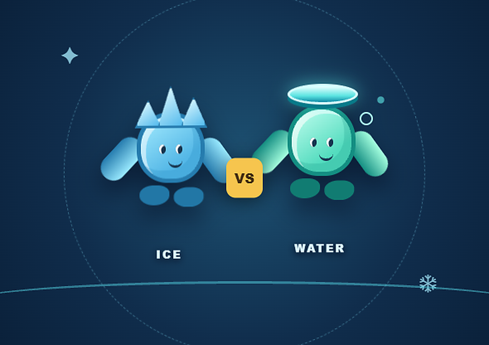

# ❄️ Frost Fall: ICE & Water — Freeze Chase

**Collect crystals, rescue your team, and stay ahead of Frost.** Frost Fall is a browser game for Windows and Android. Normal and Survival are bot-supported modes. Multiplayer rooms run from the included Node.js server and can mix human players with AI bots.

**Play online:** https://frostfall-ice-vs-water.onrender.com/

## Modes

| Mode | Setup | Goal |
|---|---|---|
| **Normal** | One human-controlled side and AI teammates/opponents | Classic arena chase. Frost hunts across the arena; Water rescues frozen teammates. |
| **Survival** | One human-controlled side and AI teammates/opponents | Collect and bank crystals on Frozen Land, then finish with Water teammates free. Islands protect one Water player; crowded islands are vulnerable. |
| **Multiplayer** | 2–8 total characters: humans first, bots fill the selected roster | Join Quick Match or create/connect to a room. A room needs at least **two human players: one Frost and one Water**. Up to two Frost and six Water characters can play. |

### Survival crystal rules

A four-minute round has eight crystal waves. One crystal appears at 0:00, then a new one appears every 30 seconds through 3:30, replacing any missed crystal. Water must bank six. The final crystal disappears at 3:45; if fewer than six are banked then, Frost wins. Water must also finish with every teammate free. Frost can freeze Water on Frozen Land and on crowded islands.

### Energy and scoring

Survival and Multiplayer show separate Frost and Water team energy bars. Each character charges and spends its own meter; your controls use the meter for your selected side/player. Water earns energy from rescues and crystals; Frost has a separate meter for a chase boost. Freed Water players receive temporary freeze protection. Scores are tracked individually: Frost earns points for freezes, Water for crystals and rescues. Team victory follows the mode’s win rules, separately from individual scores.

## Multiplayer lobby: player count, bots, and starting

The player-count selector is **inside the joined room lobby**. It controls the total roster, including humans and bots, from 2 to 8.

1. Join through **Quick Match** or create/connect to a private room. Quick Match automatically joins the shared queue; no room code is needed.
2. At least two humans must be present, with one human on Frost and one on Water. Select teams in the lobby.
3. The room host chooses **TOTAL PLAYERS (INCLUDING BOTS)** in the lobby. Example: choose 3 with two humans to add one bot. Bots are added when the match starts, not while waiting in the lobby.
4. Humans may ready up. The match auto-starts when every human is ready and both teams are represented. The host can also press **START MATCH** after those two-human/team requirements are met; the host does not need to wait for every human to ready up.
5. The server fills remaining slots with Survival-style AI: Frost bots pursue Water; Water bots seek crystals, rescue frozen teammates, and return toward islands.

The selected number is a total character count, not a count of additional bots. If the room already has more human players than the selected count, the server keeps the humans and does not remove anyone. The team cap remains two Frost and six Water.

## Play on Windows

- **Solo:** Open `index.html` in Chrome, Edge, or Firefox. Use WASD or arrow keys to move, Space for power, and P to pause.
- **Host nearby multiplayer:** Install Node.js, run `Run-Game.cmd`, and keep the server window open. Other devices open the host laptop’s network address on port 8787. Allow Node.js through Windows Firewall on a private network if prompted.

## Play on Android

Open the published link in Chrome for Normal, Survival, or Multiplayer. For a nearby laptop-hosted room, connect to the same Wi-Fi/hotspot and open the host address. Use touch controls in the arena. Google Drive preview does not run HTML games.

Bluetooth direct play is not implemented in this browser version.

## Internet rooms and Quick Match

All players must use the same public HTTPS game/server address. Quick Match groups players reaching that server; private rooms use a room invite link and optional passcode. Share the invite link, and send any passcode separately.

The server keeps room and match state in memory. A restart or redeploy ends active rooms, so create a fresh room after a server restart. Free hosting may sleep while idle and may restart; it is suitable for demos, not guaranteed always-on matches.

## Deploy on Render

Deploy the contents of this folder as a **Node Web Service** (not a static site):

| Render setting | Value |
|---|---|
| Runtime | Node |
| Build command | `npm install` |
| Start command | `npm start` |
| Root directory | blank when these files are at repository root |

After Render reports **Live**, its HTTPS URL serves both the game and multiplayer API. Test with two devices: join the same server, choose opposite teams, set the lobby roster size, ready/start, and confirm the bot count and match synchronization.

## Project files

- `index.html` — game, animated canvas arena, menus, controls, and visual player guide
- `server.js` — HTTP/API server, room state, matchmaking, AI bot movement, and authoritative match simulation
- `package.json` — Node start script and runtime requirement
- `Run-Game.cmd` — Windows local server launcher
- `Start-Remote-Tunnel.cmd` — optional temporary internet tunnel

## Developer notes

The server is authoritative for multiplayer positions, collisions, freezes, rescues, crystal waves, scoring, and results. Room endpoints are implemented in `server.js` under `/api/rooms`, `/api/matchmaking/join`, and `/api/rooms/:code/{state,events,join,ready,settings,start,input,leave}`. The browser connects to the same origin using Server-Sent Events for room updates and HTTP POST requests for player input and lobby actions.

Room state is currently in process memory. Scaling to multiple server instances or durable rooms requires shared storage and coordination; do not run this server on multiple instances for a single shared queue.
